# 📊 Predicting Customer Churn: Applied Probability, Statistics & Machine Learning in R

<p align="center">
  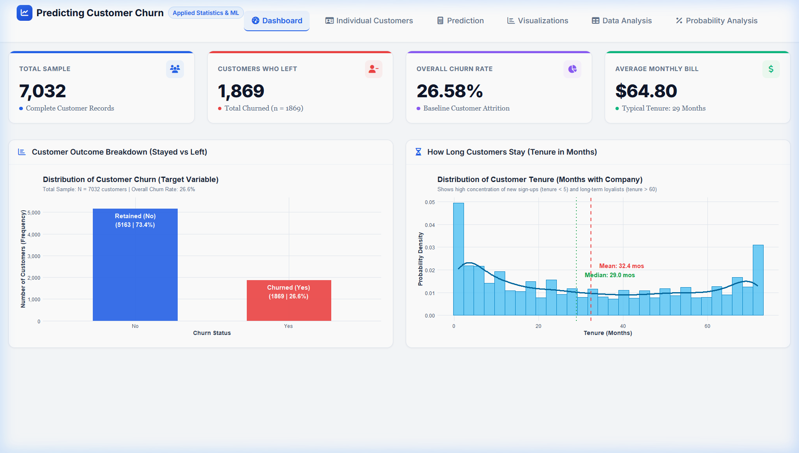
</p>

<p align="center">
  <a href="https://www.r-project.org/"></a>
  <a href="https://shiny.posit.co/"></a>
  <a href="https://github.com/Dhileepk-18"></a>
  <a href="#-model-evaluation--performance-benchmarks"></a>
  <a href="#-model-evaluation--performance-benchmarks"></a>
</p>

---

## 📌 Executive Summary

Customer attrition (or **churn**) occurs when a customer cancels or terminates their contract with a subscription or service provider. In modern telecommunications, acquiring a new customer is estimated to cost **5× to 7× more** than retaining an existing one.

This project delivers an end-to-end mathematical data science framework developed in **R (v4.6.1)**. Rather than treating churn prediction as an uninterpretable "black box," this repository emphasizes foundational principles of **Probability Theory**, **Descriptive and Inferential Statistics**, and **Binary Logistic Regression**.

The project couples comprehensive mathematical rigor with a production-grade, multi-tab **R Shiny interactive web application** and automated statistical analysis suites.

---

## 🚀 Key Highlights & Findings

- 📈 **Baseline Churn Rate:** Out of 7,032 validated customer records, **1,869 customers (26.58%)** experienced churn, establishing a baseline retention rate of **73.42%**.
- 🛡️ **The Contract Shield Effect:** Customers on two-year contracts churn at only **2.85%** ($OR = 0.208$, $79.2\%$ lower odds of churn), while month-to-month contracts experience a staggering **42.71%** churn rate ($1.61\times$ baseline risk).
- ⚠️ **First-Year Vulnerability Window:** New subscribers in their first 12 months churn at **47.68%** ($1.79\times$ baseline risk), compared to just **9.51%** for customers retained past 48 months.
- ⚡ **Fiber Optic Attrition Spike:** Fiber optic internet subscribers exhibit a high churn rate of **41.89%** ($OR = 2.457$, $145.7\%$ elevated odds), driven by high monthly charges ($\mu = \$91.50$).
- 💳 **Payment Friction:** Electronic check users churn at **45.29%**, compared to only $\approx 15\text{--}17\%$ for automated bank transfer and credit card billing.
- 🎯 **Predictive Performance:** The logistic regression model achieves **80.45% accuracy**, **0.8516 ROC-AUC**, and **88.87% specificity** on an unseen holdout test set ($n = 1,407$).

---

## 🖥️ Interactive R Shiny Dashboard Walkthrough

The web application is structured into **6 modular tabs**, providing interactive data exploration, customer lookup, and scenario simulations.

### Tab 1: Executive Dashboard
Presents real-time KPI value boxes (Total Sample, Churn Count, Attrition Rate, Average Monthly Spend) alongside distribution charts and key statistical insights.
<p align="center">
  
</p>

---

### Tab 2: Individual Customer Dossier & Directory
A searchable customer directory across all 7,032 profiles. Search by customer name or ID, or click **"Pick Random Customer"** to view a full profile card, actual churn outcome, and predicted risk score.
<p align="center">
  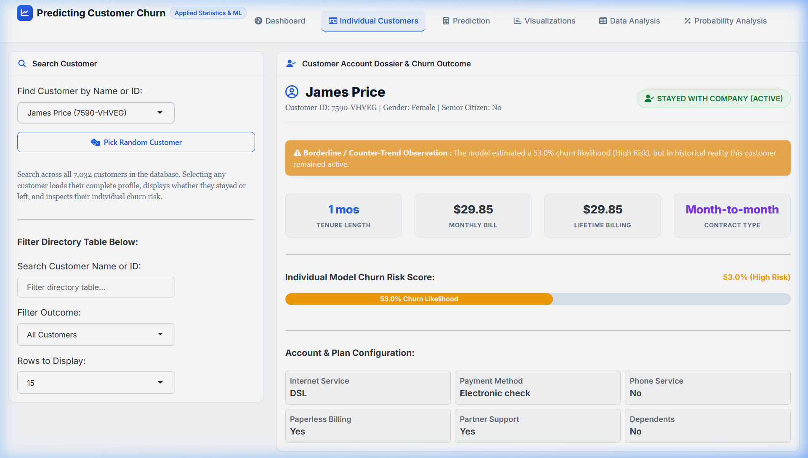
</p>

---

### Tab 3: What-If Churn Simulator & Prediction Engine
Interactive scenario simulator allowing business stakeholders to vary customer tenure, monthly spend, contract type, internet technology, and payment method to compute real-time churn probability and examine model test metrics.
<p align="center">
  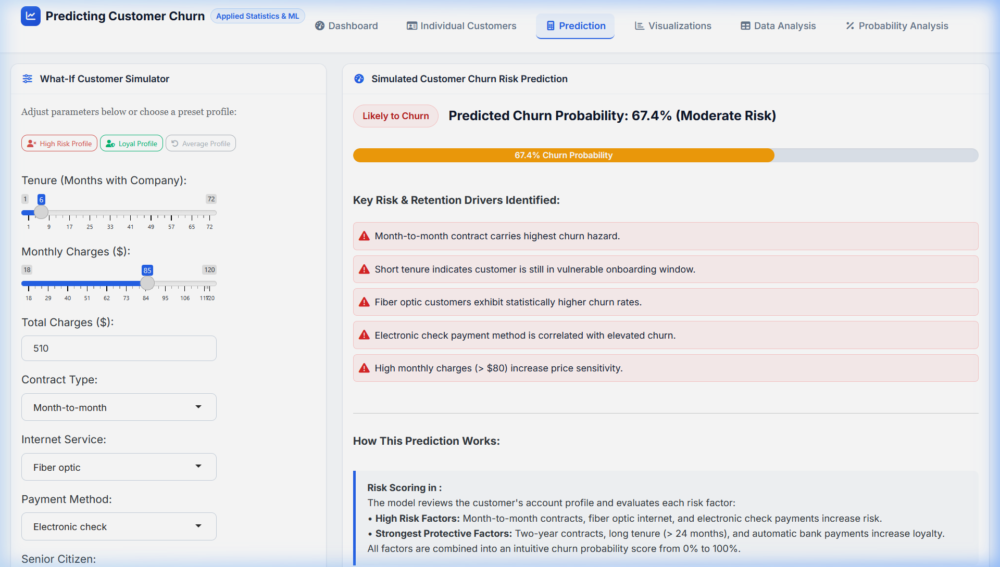
</p>

---

### Tab 4: Statistical Visualizations Gallery
High-resolution, publication-grade ggplot2 visualizations with dynamic dropdown selections: histograms with kernel density overlays, faceted bar charts, boxplots with quartile markers, and correlation heatmaps.
<p align="center">
  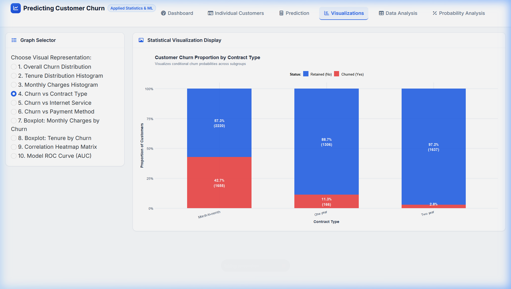
</p>

---

### Tab 5: Probability & Conditional Risk Engine
Computes marginal, joint, and conditional probabilities $P(A \mid B)$, relative risk ratios, and risk multipliers across contractual, demographic, and billing dimensions.
<p align="center">
  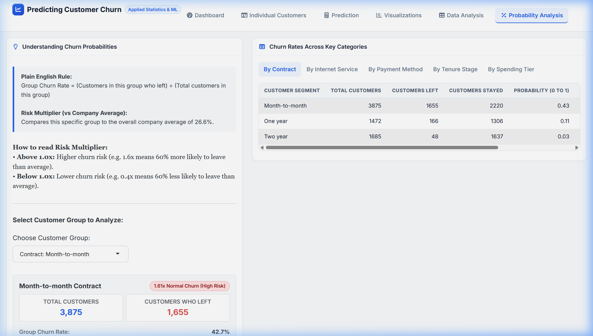
</p>

---

## 📐 Mathematical & Statistical Foundations

This project bridges classroom statistical theory and real-world telecommunications analytics:

### 1. Classical Probability
The empirical probability of event $A$ is given by:
$$P(A) = \frac{n(A)}{N}$$
- **Baseline Churn Probability:** $P(\text{Churn} = \text{Yes}) = \frac{1,869}{7,032} = 0.2658 \quad (26.58\%)$
- **Baseline Retention Probability:** $P(\text{Churn} = \text{No}) = 1 - P(\text{Churn}) = 0.7342 \quad (73.42\%)$

### 2. Conditional Probability & Relative Risk Multipliers
The conditional probability of churn given an observed characteristic $B$ is:
$$P(\text{Churn} \mid B) = \frac{P(\text{Churn} \cap B)}{P(B)} = \frac{n(\text{Churn} \cap B)}{n(B)}$$
$$\text{Relative Risk (RR)} = \frac{P(\text{Churn} \mid B)}{P(\text{Churn})}$$
- **Month-to-month contracts:** $P(\text{Churn} \mid \text{Month-to-month}) = \frac{1,655}{3,875} = 42.71\% \implies \text{RR} = 1.61\times$
- **Two-year contracts:** $P(\text{Churn} \mid \text{Two year}) = \frac{48}{1,685} = 2.85\% \implies \text{RR} = 0.11\times$
- **Tenure $\le 12$ months:** $P(\text{Churn} \mid \text{Tenure} \le 12) = 47.68\% \implies \text{RR} = 1.79\times$
- **Tenure $> 48$ months:** $P(\text{Churn} \mid \text{Tenure} > 48) = 9.51\% \implies \text{RR} = 0.36\times$

### 3. Descriptive Measures of Central Tendency & Dispersion
- **Sample Mean:** $\bar{x} = \frac{1}{n}\sum_{i=1}^n x_i$  
  *(Tenure: $32.42$ mos, Monthly Charges: $\$64.80$, Total Charges: $\$2,283.30$)*
- **Sample Median ($Q_2$):** 50th percentile robust against extreme skewness.  
  *(Total Charges Median: $\$1,397.47$ vs. Mean: $\$2,283.30$, confirming right-skewness)*
- **Sample Variance & Standard Deviation:**  
  $$s^2 = \frac{1}{n-1}\sum_{i=1}^n (x_i - \bar{x})^2, \quad s = \sqrt{s^2}$$
  *(Tenure $s = 24.55$ mos, Monthly Charges $s = \$30.09$)*

### 4. Bivariate Inferential Hypothesis Testing
- **Pearson's Chi-Square Test of Independence ($\chi^2$):**
  $$\chi^2 = \sum \frac{(O - E)^2}{E}, \quad df = (r - 1)(c - 1)$$
  Evaluated for all categorical attributes (`Contract`, `InternetService`, `PaymentMethod`, etc.). All yield $p < 10^{-100}$, rejecting $H_0$ and confirming statistically significant associations with churn.
- **Welch's Two-Sample $t$-Test:**
  $$t = \frac{\bar{x}_1 - \bar{x}_2}{\sqrt{\frac{s_1^2}{n_1} + \frac{s_2^2}{n_2}}}$$
  Demonstrates that retained customers have significantly higher tenure ($37.65$ vs $17.98$ months, $p = 2.35 \times 10^{-234}$) and significantly lower monthly charges ($\$61.31$ vs $\$74.44$, $p = 8.60 \times 10^{-73}$).
- **Pearson Correlation Coefficient ($r$):**
  $$r = \frac{\sum (x_i - \bar{x})(y_i - \bar{y})}{\sqrt{\sum (x_i - \bar{x})^2 \sum (y_i - \bar{y})^2}}$$
  Reveals strong linear correlation between `tenure` and `TotalCharges` ($r = 0.8259, p < 10^{-300}$).

### 5. Binary Logistic Regression
Models log-odds of customer churn as a linear function of $k$ independent predictors:
$$\ln\left(\frac{p}{1 - p}\right) = \beta_0 + \sum_{j=1}^k \beta_j X_j \implies p = \frac{1}{1 + e^{-(\beta_0 + \sum \beta_j X_j)}}$$

The **Odds Ratio ($\text{OR} = e^{\beta_j}$)** reflects the multiplicative change in the odds of churn for a unit increase in $X_j$:
- Two-Year Contract: $\beta = -1.572 \implies \text{OR} = 0.208$ ($79.2\%$ lower churn odds).
- Fiber Optic Internet: $\beta = +0.899 \implies \text{OR} = 2.457$ ($145.7\%$ higher churn odds).
- Each Additional Month of Tenure: $\beta = -0.059 \implies \text{OR} = 0.943$ ($5.7\%$ lower churn odds per month).

---

## 📊 Visualizations Gallery

| Churn Distribution | Tenure Distribution (Density) | Monthly Charges Distribution |
| :---: | :---: | :---: |
| 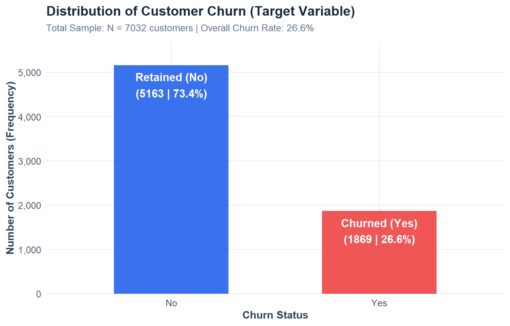 | 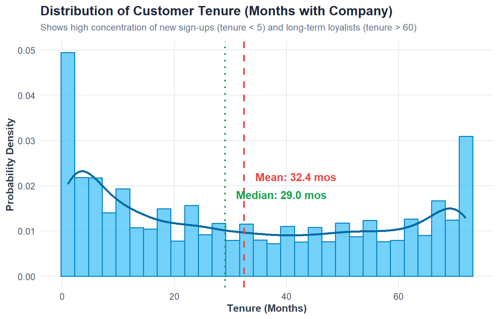 | 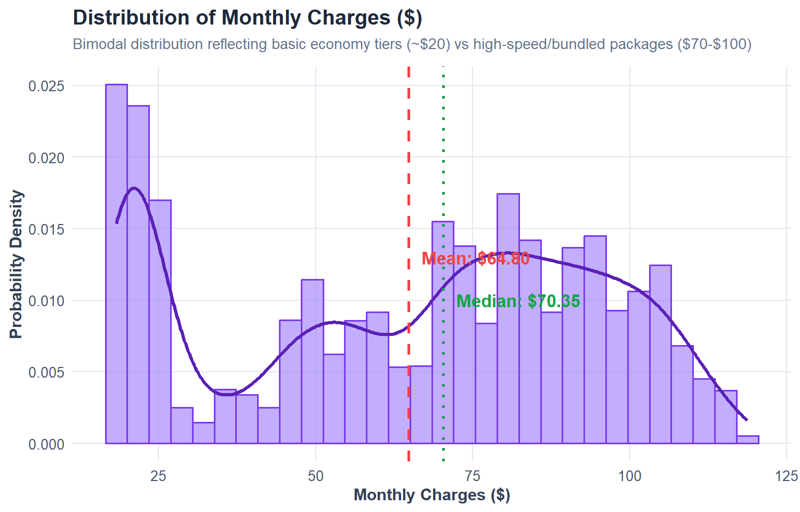 |

| Churn by Contract Type | Churn by Internet Service | Churn by Payment Method |
| :---: | :---: | :---: |
| 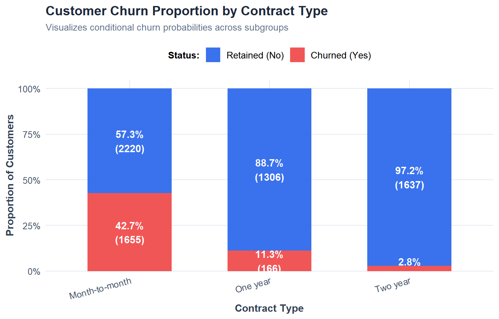 | 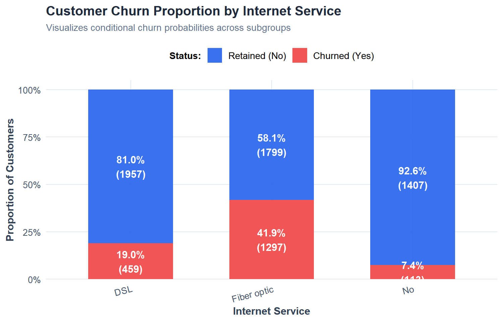 | 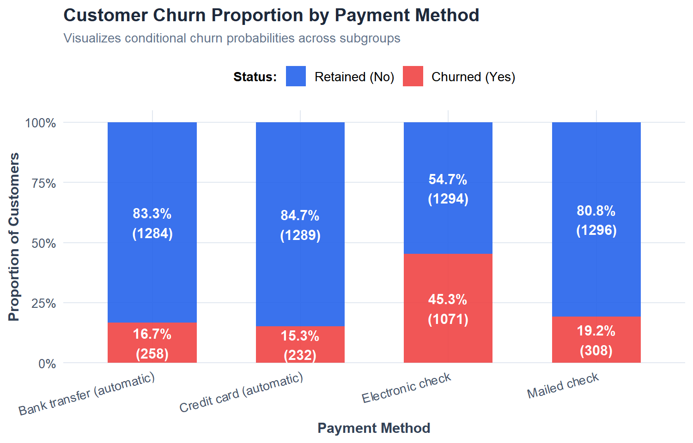 |

| Monthly Charges Boxplot | Tenure Boxplot | Correlation Heatmap |
| :---: | :---: | :---: |
| 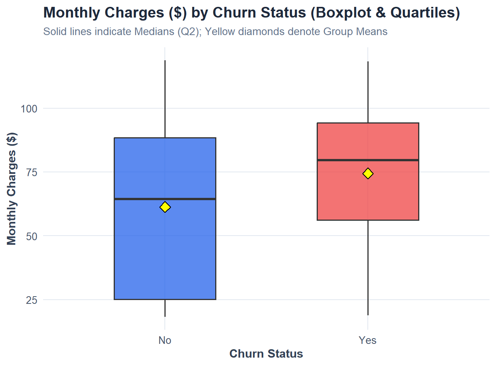 | 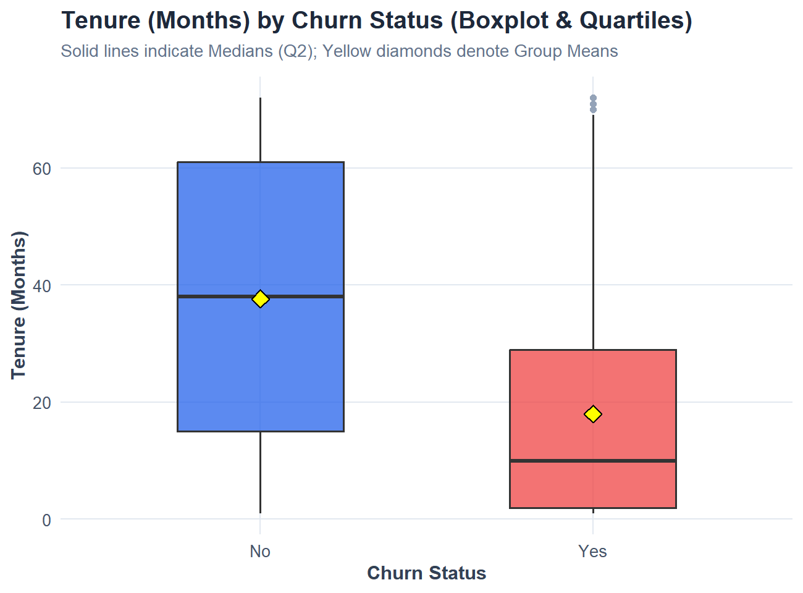 | 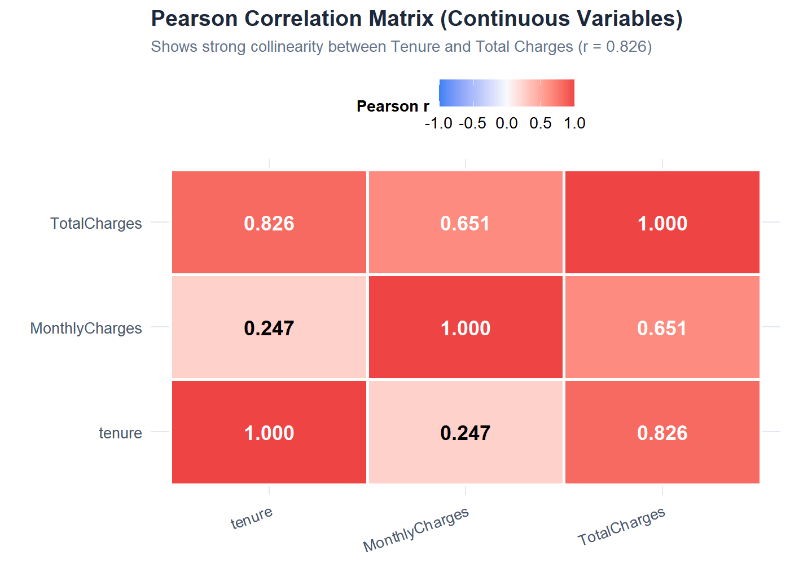 |

---

## 🎯 Model Evaluation & Performance Benchmarks

Evaluated on the **20% holdout test dataset** ($n = 1,407$ complete cases):

| Performance Metric | Mathematical Formulation | Test Score | Percentage |
| :--- | :--- | :---: | :---: |
| **Accuracy** | $(TP + TN) / \text{Total}$ | **0.8045** | **80.45%** |
| **Specificity (True Negative Rate)** | $TN / (TN + FP)$ | **0.8887** | **88.87%** |
| **Precision (Positive Predictive Value)** | $TP / (TP + FP)$ | **0.6505** | **65.05%** |
| **Recall / Sensitivity (True Positive Rate)** | $TP / (TP + FN)$ | **0.5722** | **57.22%** |
| **F1-Score** | $2 \cdot \frac{\text{Precision} \cdot \text{Recall}}{\text{Precision} + \text{Recall}}$ | **0.6088** | **60.88%** |
| **ROC-AUC (Area Under ROC Curve)** | $\int_{0}^{1} \text{TPR}(t) \, dt$ | **0.8516** | **85.16%** |

### Confusion Matrix (Test Set, Threshold = 0.50):
| Actual \ Predicted | Predicted: Stayed (0) | Predicted: Churned (1) | Total Actual |
| :--- | :---: | :---: | :---: |
| **Actual: Stayed (No)** | **918** (TN) | **115** (FP) | 1,033 |
| **Actual: Churned (Yes)** | **160** (FN) | **214** (TP) | 374 |
| **Total Predicted** | 1,078 | 329 | **1,407** |

<p align="center">
  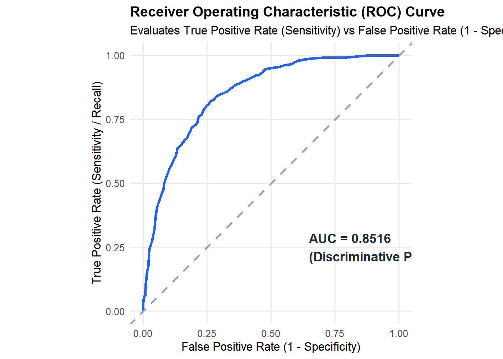
</p>

---

## 📁 Repository Structure

```
Customer_churn/
├── .Rprofile                           # Project-level R environment library config
├── .gitignore                          # Clean git ignore configuration
├── app.R                               # Interactive R Shiny dashboard (6 tabs, bslib theme)
├── run_app.bat                         # 1-Click Windows execution launcher script
├── install_packages.R                  # Automated dependency verification and installer
├── data/
│   └── customer_churn.csv              # Telco customer dataset with unique names (7,043 rows)
├── R/
│   ├── data_cleaning.R                 # Ingestion, NA handling, factors, demographic generator
│   ├── statistics.R                    # Descriptive statistics, moments, cross-tabulations
│   ├── probability.R                   # Probability engine (marginal, conditional, relative risk)
│   ├── visualization.R                 # Publication-grade ggplot2 plotting suite
│   └── prediction.R                    # Logistic regression, confusion matrix, ROC-AUC
├── report/
│   └── generated_assets/
│       ├── web_screenshots/           # Live R Shiny interface screenshots (5 screens)
│       ├── web_plots/                 # High-resolution ggplot2 graphics (10 plots)
│       └── console_imgs/              # Rendered terminal and R console output cards
└── README.md                           # Master repository documentation
```

---

## ⚙️ Quickstart & Installation

### Prerequisites
- Install **R (v4.0 or higher)** from [CRAN](https://cran.r-project.org/).
- *(Optional)* Install [RStudio Desktop](https://posit.co/download/rstudio-desktop/).

### Step 1: Clone the Repository
```bash
git clone https://github.com/Dhileepk-18/Customer_churn.git
cd Customer_churn
```

### Step 2: Install Required R Packages
Run the automated dependency installer from the command line:
```bash
Rscript install_packages.R
```
*Or from inside R / RStudio:*
```R
source("install_packages.R")
```

The script ensures all dependencies (`shiny`, `bslib`, `ggplot2`, `dplyr`, `scales`, `pROC`, etc.) are installed and verified.

### Step 3: Launch the Interactive Web Application

#### Option A: 1-Click Launch on Windows (Recommended)
Double-click `run_app.bat` or run in PowerShell:
```powershell
.\run_app.bat
```

#### Option B: Terminal Command
```bash
Rscript -e "shiny::runApp('.', port = 3838, launch.browser = TRUE)"
```

#### Option C: In RStudio
Open `app.R` in RStudio and click the green **"Run App"** button in the editor toolbar.

The dashboard will open automatically in your browser at:
```
http://127.0.0.1:3838
```

---

## 🔬 Running Individual Analysis Modules

Each file in the `R/` directory is standalone and can be executed independently:

```bash
# Data Cleaning & Ingestion Summary
Rscript R/data_cleaning.R

# Descriptive Statistics & Hypothesis Tests (Chi-Square, t-test, correlation)
Rscript R/statistics.R

# Marginal & Conditional Probability Engine
Rscript R/probability.R

# Logistic Regression Training & Holdout Test Evaluation
Rscript R/prediction.R
```

---

## 👤 Author & Acknowledgments

- **Author:** **K. Dhileep kumar** ([@Dhileepk-18](https://github.com/Dhileepk-18))
- **Institution:** Applied Probability and Statistics Laboratory
- **Dataset:** IBM Telco Customer Churn Sample Dataset
